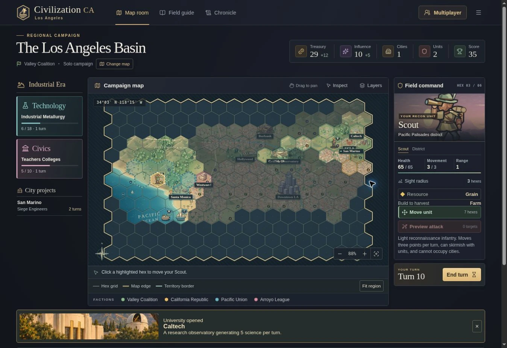

# Civitas LA · California Campaigns

A turn-based strategy game for one to four players, set on three hand-authored, 221-hex maps. Open Los Angeles, San Francisco Bay or San Diego to settle cities, run a fleet and advance from the Frontier into the Industrial and Modern eras.

[Play on GitHub Pages](https://wanzhengyan.github.io/Civilization-LA/) · [Hosted game](https://angel-basin-civilization.gifteddream3.chatgpt.site/) · [Release notes](./CHANGELOG.md)



[中文版实机画面](./media/board-zh.webp)

## Start a campaign

- For solo play, choose **Change map** next to the region title to start or resume a campaign. The diagrams in the picker show each scenario's coastline and land.
- For a network game, open **Multiplayer**, select the map and create a room. Send its invitation link to one to three friends. The host starts once everyone has joined. Returning in the same browser restores the player's seat.
- Change the interface between English and Simplified Chinese in the upper-right **Game menu**. Each online player can choose their own language.

## Play your opening turns

1. Select your settler and open the settlement survey. Gold flags mark sites you can settle immediately. Blue flags mark sites where the unit will need its next turn to found the city.
2. Use **Technology** and **Civics** on the left of the map. Science and culture build up separately. A technology can change production, military capability or trade. A civic can change how a faction grows or issues orders.
3. Open a city's production menu. The available units change with discoveries. Militia can capture cities, ranged units can damage defenders, and later discoveries open specialized cavalry, infantry, artillery and armored units. Inspect the attack forecast before committing.
4. Establish a harbor on a suitable controlled shore. A fishing crew can improve nearby water, a cutter patrols the coast, and a shipyard plus Steam Power unlocks a steam frigate. Ships travel on connected sea hexes. A full berth can delay a launch.
5. Capture all original capitals for a domination victory, or lead the score when a faction reaches 125 points or round 30 ends.

**中文快速开始。** 点击右上角游戏菜单切换到简体中文。新建单人战役或创建联机房间时可选地图。先选开拓者查找新城位置，再从地图左侧各选一项科技和市政。经营沿海城市可以修建港口、派渔船建设渔场，或建造军舰争夺沿岸水域。

## Run locally

Use Node.js 22.13 or newer. From the repository root, run:

```sh
npm run dev
```

Open [the local game](http://127.0.0.1:8080/Civilization-LA/). The development server serves the frontend and the room API together, with room data saved in `.civitas-local/`. Open a private window or a second browser to join as a different player. Run the rules and multiplayer regression tests with:

```sh
npm test
```

Run `npm run playtest` to replay 18 campaigns twice across all three maps. See the [development notes](./DEVELOPMENT.md) and [changelog](./CHANGELOG.md) for the game systems and release history.

| File | Purpose |
| --- | --- |
| `docs/index.html`, `docs/styles.css` | Game board, controls and layout |
| `docs/hud.js`, `docs/game.js` | Map interaction, solo sessions, room membership and synchronization |
| `docs/atlas.js`, `docs/unit-art.js` | Regional map and unit rendering |
| `docs/rules.js` | Rules shared by the browser and the authoritative room service |
| `lib/room-service.js`, `lib/room-http.js` | Room validation, persistence and cross-origin access |
| `drizzle/`, `worker.js` | Database migrations and the Cloudflare Worker entry point |

## Publish the frontend on GitHub Pages

This repository publishes the contents of `docs/` at the root of its `gh-pages` branch. For a fork, you can instead select **Deploy from a branch → main → /docs** in **Settings → Pages**. GitHub displays the published URL after deployment. Asset paths are relative, so the game works under a repository path such as `/Civilization-LA/`. [GitHub Pages documentation](https://docs.github.com/en/pages/getting-started-with-github-pages/configuring-a-publishing-source-for-your-github-pages-site)

Solo play runs entirely in the browser. The `civitas-api-origin` meta tag in `docs/index.html` selects the room service for multiplayer. The maintained service allows the project's GitHub Pages origin, `https://wanzhengyan.github.io`. For a fork under a different account or a custom domain, configure the room service for that origin using the steps below.

## Deploy an independent room service

A Cloudflare Worker handles `/api/room`, and D1 stores room membership, turns and game state.

1. Sign in with Wrangler, create the D1 database and copy the example configuration.

   ```sh
   npx wrangler@4 login
   npx wrangler@4 d1 create civitas-la-rooms
   cp wrangler.example.jsonc wrangler.jsonc
   ```

2. In `wrangler.jsonc`, enter the database ID from the previous command and keep `DB` as its binding name. Set `PROJECT_ORIGIN` to the scheme and host of your frontend, such as `https://your-account.github.io`.
3. Apply the migrations and publish the Worker.

   ```sh
   npx wrangler@4 d1 migrations apply civitas-la-rooms --remote
   npx wrangler@4 deploy
   ```

4. Set `civitas-api-origin` in `docs/index.html` to the deployed Worker's HTTPS origin and push your change. Use separate browser sessions to create and join a room, move a unit, and confirm both players see the same board. [Cloudflare D1 migration documentation](https://developers.cloudflare.com/d1/reference/migrations/)

The interface uses Lucide icons. [Third-party notices](./THIRD-PARTY-NOTICES.txt)
