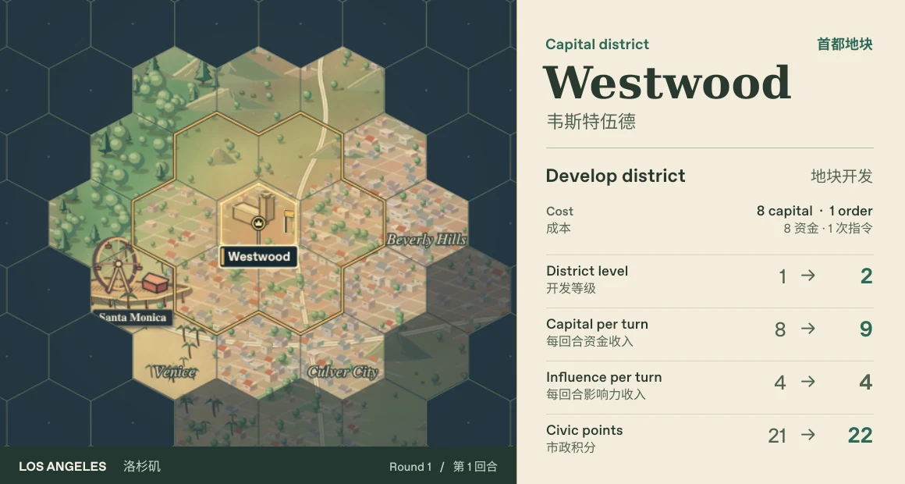

# Civilization CA

A bilingual, turn-based strategy game for one to four players. Each California campaign begins with one settler, a chosen or randomly drawn civilization and a new starting location. Choose Los Angeles, San Francisco Bay or San Diego, and a Large, Grand or Epic map. Practice on your own, face computer rivals or invite friends to a team match.

[Official website](https://wanzhengyan.github.io/Civilization-CA/) · [Play solo](https://wanzhengyan.github.io/Civilization-CA/game.html?setup=solo) · [Create a room](https://wanzhengyan.github.io/Civilization-CA/game.html?setup=host) · [Watch a campaign](https://wanzhengyan.github.io/Civilization-CA/#film) · [Campaign updates](./CHANGELOG.md)


[English campaign board](./media/board-preview.webp)

[中文实机画面](./media/board-zh.webp)

## Enter a campaign

Choose **Play solo** to set your civilization, the number of computer opponents and how the campaign can be won. **Conquest** rewards control of every original capital or the elimination of the last rival team. **Science** requires researching Rocketry and completing the Orbital Survey in a city. **Standard** allows either victory. In zero-opponent practice, the science route gives you an objective to pursue at your own pace. Neutral camps still roam the map. Older saves keep their original victory rules.

Large, the smallest new map, has 598–689 playable hexes. Grand has 1,346–1,545 and Epic has 2,391–2,747. Westwood spans five hexes on a Large Los Angeles map and sixteen on Epic. You can resume an earlier compact map from its saved slot. Each region and size has its own solo save. Resuming keeps the original opponents and goal. Starting a new campaign in an occupied slot requires confirmation. **Create room** lets the host set the region and size for everyone. **Join room** accepts a room code or invitation. Switch between English and 简体中文 on the website or during play.

Drag the map or pinch to zoom. Technology and Civics sit on the left, with Field Command on the right. **Fit region** shows the whole playable coastline. A double line marks the last playable hex, and a shared border shows the color of each civilization on its own side. Select a frontier district to identify its neighbors.

Visible cities carry a nameplate on their own hex. A gold crown marks an original capital and stays with it after capture. The rim shows the current owner. Select a nameplate to inspect the city. Turning off geographic names keeps city names on the board.

Select owned land and open **District development** in Field Command. Compare the treasury cost, the district order spent, income per turn and civic points before you commit. In the Westwood opening below, upgrading the city tile from level 1 to 2 spends 8 capital and one order. Capital income goes from 8 to 9 per turn, influence income stays at 4 and civic points rise from 21 to 22.



The city production menu shows the units, buildings and projects your civilization has unlocked. After researching Radio Networks and Motorization you can study Rocketry, then commit 60 city production to the Orbital Survey in a Standard or Science game. The survey must be built. The science and civic trees show what you can unlock next. Open **Battle reports** to see who attacked, how much damage each side took and where the fight happened. Ranged strikes cause zero retaliation damage to the attacker, even when the target is adjacent. A later enemy attack is a separate event. **Replay on map** returns to that district. When the attacker fired from beyond your sight, the report identifies the impact location and keeps the source hidden.

The visitor footer counts anonymous browser profiles on each site from the day the counter launched. Refreshing or opening a second tab on the same site does not add another visitor. The public totals are shared between the two hosts. Day and month follow Los Angeles time.

## Choose a civilization

Each trait works in the original capital while its founder controls it. All four start with a single settler, the same treasury and the same sight.

| Civilization | Capital bonus per turn |
| --- | --- |
| California Republic | +1 production |
| Pacific Union | +2 gold |
| Valley Coalition | +2 food |
| Arroyo League | +1 science |

## City and unit orders

- The green hex by an owned city name forecasts its next border expansion at its current population. Open the city to locate the proposed district. Each resident contributes one border point when its owner ends their turn. The first district takes eight points.
- On your turn, open city production to change projects. Work already invested in an item stays with that city. For a building, choose a highlighted site on the board and confirm. Eligible buildings and units can also be bought with gold. The purchase quote deducts work already invested.
- Select a unit to inspect its upgrade paths, prerequisites, service location, gold price and outcome. A wounded unit shows its expected recovery. Rest spends its remaining movement for additional healing. Ships return to a friendly service location for repairs.
- Open the treasury or influence counter to see current holdings, income and uses. The first policy is free and changing it costs 3 influence. A border contest costs 4 gold and 5 influence, plus 2 influence per district level.

## Your first expedition

1. Select your settler. Decide whether to found immediately, move to a different site, or spend a movement point surveying nearby resources. Nobody begins with a city, army or claimed land. The first city you found becomes your original capital.
2. Train a **Scout** to explore. All units see two hexes in every direction. A scout gets three movement points to a militia unit’s two. After researching Topographic Mapping, scouts and mounted scouts spend one point to enter foothills. The map distinguishes uncharted land, places you remember, and tiles you can currently observe. In a team game, allies contribute their current sight, discoveries and surveyed deposits to the same chart.
3. Choose research and a civic in the left rail, then train a **Builder**. An improved deposit supplies a city only when it is connected to controlled territory. Check the stockpile for your actual income. Fishing crews work marine sites from a harbor.
4. Inspect the city's food reserve, consumption, housing and next expected population change. Switch its workforce focus to favor food, industry or science. Granaries and residential quarters can expand housing.
5. Watch for neutral lookouts as the map opens. Returning lookouts can warn a camp and lead to a raid. Intercept a party, protect a city with a garrison or walls, or clear the source with a ground unit.
6. Open the councils and look up **UCLA**, **Stanford**, **UC Berkeley** and **Caltech**. Their respective discoveries or charters unlock construction. Pick eligible owned land, compare specialties and commit a city to the project. Each university can finish once per world.

| University | Unlock | Base yield per turn |
| --- | --- | --- |
| UCLA | Municipal Charter (civic) | 3 culture, 1 science |
| Stanford University | Workshop Engineering (technology) | 2 production, 2 science |
| UC Berkeley | Park Conservancies (civic) | 4 science |
| Caltech | Steam Power (technology) | 5 science |

California also has six natural wonders, two in each new regional campaign. A unit can discover La Brea Tar Pits in Los Angeles, Mount Tamalpais in the Bay Area, or Cabrillo Tide Pools in San Diego. Citizens working neighboring districts receive the site's bonus. Open **Field guide → Wonders → Show on map** to revisit a discovery. An older campaign keeps its original coastline and terrain when you resume it.

A favored site adds one unit of the university’s specialty yield. Existing improvements and resource deposits are protected from campus construction.

Open **Change map** to choose a different region. In **Create room**, pick two to four seats, then choose a human or computer controller for each seat. You can start as the only human with computer opponents, invite a friend to join your team, or put a computer on each side. Set each computer to Easy, Normal or Hard. Easy develops home districts and patrols nearby. Normal scouts and compares targets. Hard compares attacks across units and looks for an explored site for its next city. Each starts with the same economy, sight and unit rules as a human. Reserved human seats must be filled before the host starts.

Each team shares sight and explored terrain. In a new team room both allies can give orders to their own pieces during the same turn. Mark ready when finished. The next team starts once all surviving teammates are ready. Teammates keep separate treasuries and production queues. Teammates can defend each other’s cities and win together. The host sets the victory mode. Each human can choose a free civilization or draw one at random, and the host sets the computer players’ choices. Configured rooms draw the opening team and then a member of that team. Assign the same team to friends you want on your side. Players can use different languages. Use **Game menu → 简体中文** to switch, including during a match.

## 中文快速开始

点击「开始单人战役」可选文明、0–3 个电脑对手和胜利方式。征服胜利要求控制各方初始首都，或淘汰所有敌队。科技胜利要求研究无线电网络和机械化，再研究火箭技术，在一座城市投入 60 产能完成轨道勘测计划。标准模式允许两条路线。零对手练习可以按自己的节奏挑战科技胜利，地图上仍有野蛮人营地。每个地区和尺寸分别存档。新地图可选大型、宏大或史诗，历史标准地图可从原存档继续。继续旧档会沿用原对手和目标，确认重开后才会替换该存档。联机地图由房主选择。建房时先选 2–4 个席位，再逐席选择真人或电脑、所属队伍和电脑难度。想和朋友合作，可以把两名真人分在同一队，给另一队安排电脑。预留的真人到齐后即可开局；房主也可以独自与电脑开战。

建房时可选标准、征服或科技胜利。真人在大厅选择自己的文明，房主为电脑选文明，也可保留随机。队友可以协防城市，按本局选定的条件共同获胜。配置房间先抽先手队伍，再从队内抽出先手玩家。简单电脑倾向开发家门口的地块；一般电脑会侦察并挑选交战目标；困难电脑会比较多支部队的进攻顺序，为下一座城寻找已探明的选址。三个难度均沿用相同的视野、资源和单位规则。队友共享当前视野、已探索地形和已勘探资源。新建的组队房允许双方同时指挥各自单位。队内所有在场成员都点准备后，才会轮到对方。

文明特性在原建国者持有的初始首都生效。加州共和国每回合多 1 产能，太平洋联盟多 2 金币，山谷联盟多 2 粮食，阿罗约同盟多 1 科研。

首页可以开始或继续单人战役、创建房间，也可以用房间码或邀请链接加入多人游戏。地图上的双线为可玩边缘，界外有斜纹，地块格线可以在图层中单独开关。开局只有一名开拓者。所有单位的基础视野都是两格，侦察兵移动更快，研究地形测绘后进入丘陵只需一点移动力。你可以就地建都，也可以先移动或勘探。建城后训练侦察兵拓展视野，再派建造者到城市控制范围内开发资源。城市人口需要粮食与住房。遇到野蛮人斥候时，可以选择拦截、驻军或清除营地。大学奇观需要相应的科技或市政，在符合条件的领地自由选址。四所大学在每局游戏中都只能各建成一次。

有视野的城市会在本格显示城名。金色王冠代表初始首府，易手后保留王冠，边框颜色随现任控制方改变。点击城名即可查看城市，关闭地理名称图层后仍可辨认城市。

选中己方陆地，在战场指挥中打开「地区开发」，就能比较升级前后的每回合资金、每回合影响力和市政积分。升到 1、2、3 级分别花费 5、8、11 资金，每次消耗一次地区指令。上图的韦斯特伍德升到 2 级后，每回合资金从 8 增至 9，影响力收入维持 4，市政积分从 21 增至 22。开采资源要另派建造者修建对应设施。

科技与市政位于地图左侧，战场指挥位于右侧。在城市生产里可以查看当前已解锁的选项，后续解锁条件可在科技树和市政树中查看。远程攻击即使贴身射击也不会让攻击者受到反击伤害。打开「战报」可回放敌袭，查看双方实际损失。新战役中每个地区有两处自然奇观，市民在相邻地块工作会获得加成。在「游戏指南 → 奇观」中可以定位自己发现的地点。

城市名牌旁的绿色六边形显示预计还需几回合扩地。人口每回合贡献等量扩地进度，第一块地需要 8 点。点开城市可以定位预计获得的地块。己方回合内可切换生产项目，已投入的产能留在该城。建造建筑时，在主地图的高亮格上确认位置。符合条件的单位和建筑可以花金币购买。

点开单位可查看各条升级路线、解锁条件、地点、费用和升级结果。受伤单位也会显示下次预计恢复的生命值。点金库或影响力，可以查到余额、收入和用途。

## Run locally

Use Node.js 22.13 or newer. From the repository root, run:

```sh
npm run dev
```

Open [the local game](http://127.0.0.1:8080/Civilization-CA/). The development server serves the frontend and the room API together, with room data saved in `.civitas-local/`. Open a private window or a second browser to join as a different player. Run the rules and multiplayer regression tests with:

```sh
npm test
```

Run `npm run playtest` to replay 18 campaigns twice across all three maps. See the [development notes](./DEVELOPMENT.md) and [changelog](./CHANGELOG.md) for the game systems and release history.

| File | Purpose |
| --- | --- |
| `docs/index.html`, `docs/official.js`, `docs/official.css` | Bilingual official website and campaign entry links |
| `docs/game.html`, `docs/styles.css` | Game board, controls and layout |
| `docs/hud.js`, `docs/game.js` | Map interaction, solo sessions, room membership and synchronization |
| `docs/atlas.js`, `docs/unit-art.js` | Regional map and unit rendering |
| `docs/rules.js` | Rules shared by the browser and the authoritative room service |
| `lib/room-service.js`, `lib/room-http.js` | Room validation, persistence and cross-origin access |
| `drizzle/`, `worker.js` | Database migrations and the Cloudflare Worker entry point |

## Publish the frontend on GitHub Pages

This repository publishes the contents of `docs/` at the root of its `gh-pages` branch. For a fork, you can instead select **Deploy from a branch → main → /docs** in **Settings → Pages**. GitHub displays the published URL after deployment. Asset paths are relative, so the game works under the repository path selected by GitHub Pages. [GitHub Pages documentation](https://docs.github.com/en/pages/getting-started-with-github-pages/configuring-a-publishing-source-for-your-github-pages-site)

Solo play runs entirely in the browser. Set the `civitas-api-origin` meta tag in both `docs/game.html` and `docs/index.html` to connect the game rooms and website visitor counts to the same service. The maintained service allows the project's GitHub Pages origin, `https://wanzhengyan.github.io`. For a fork under a different account or a custom domain, configure the room service for that origin using the steps below.

## Deploy an independent room service

A Cloudflare Worker handles `/api/room` and `/api/visits`. D1 stores room membership, turns, game state and the anonymous visit counters.

1. Sign in with Wrangler, create the D1 database and copy the example configuration.

   ```sh
   npx wrangler@4 login
   npx wrangler@4 d1 create civitas-la-rooms
   cp wrangler.example.jsonc wrangler.jsonc
   ```

2. In `wrangler.jsonc`, enter the database ID from the previous command and keep `DB` as its binding name. Set `PROJECT_ORIGIN` to the scheme and host of your frontend, such as `https://your-account.github.io`.
3. Apply the migrations and publish the Worker.

   ```sh
   npx wrangler@4 d1 migrations apply civitas-la-rooms --remote
   npx wrangler@4 deploy
   ```

4. Set `civitas-api-origin` in both HTML entry points to the deployed Worker's HTTPS origin and push your change. Use separate browser sessions to create and join a room, move a unit, and confirm the active turn is synchronized and each player sees their own explored area. [Cloudflare D1 migration documentation](https://developers.cloudflare.com/d1/reference/migrations/)

The interface uses Lucide icons. [Third-party notices](./THIRD-PARTY-NOTICES.txt)
