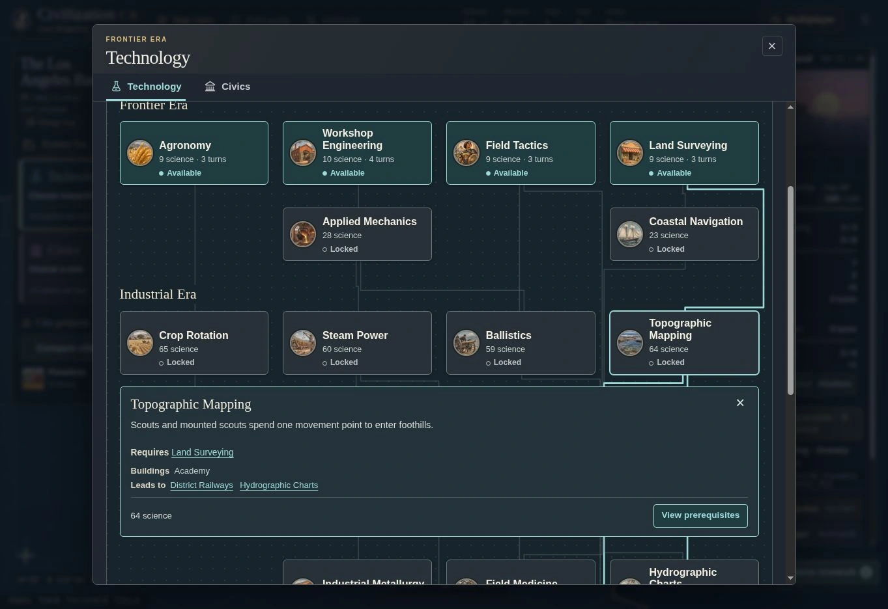
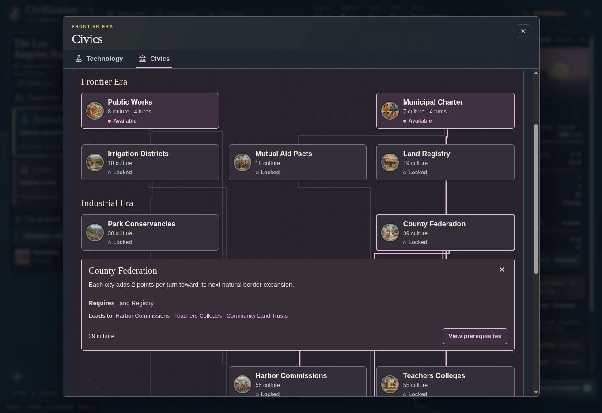
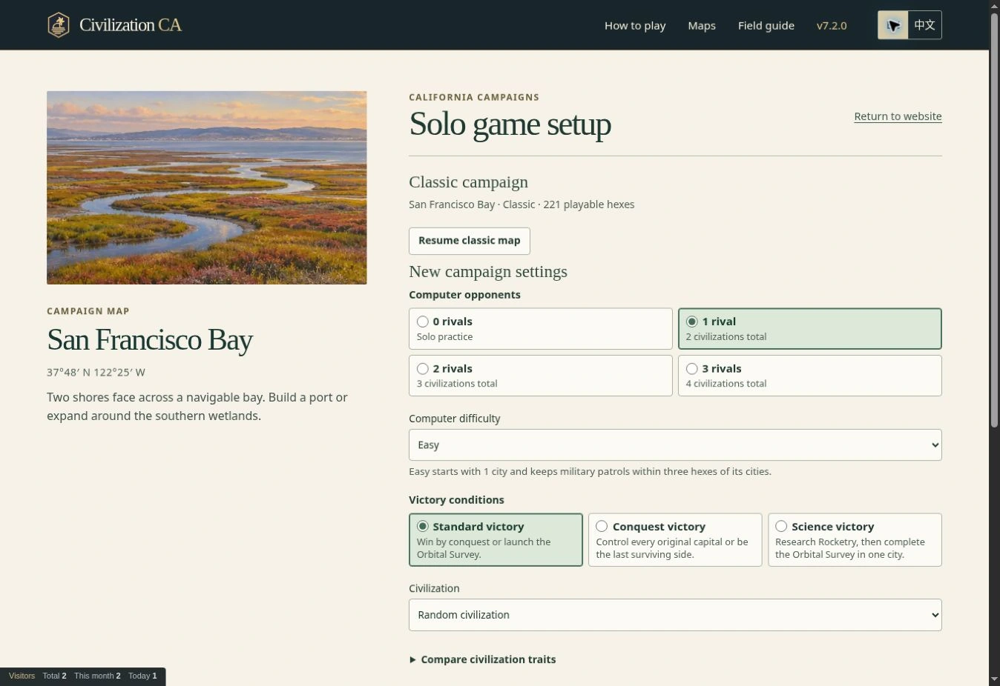

# Civilization CA

A turn-based strategy game for one to four players, set in Los Angeles, San Francisco Bay and San Diego. Start with a settler, found a capital, and explore the coast one hex at a time. A harbor can open a route into the interior. A well-placed university can bring your next discovery several turns closer.

**[Play the Pasadena tutorial](https://wanzhengyan.github.io/Civilization-CA/game.html?setup=tutorial)** · [Start a solo campaign](https://wanzhengyan.github.io/Civilization-CA/game.html?setup=solo) · [Play with friends](https://wanzhengyan.github.io/Civilization-CA/game.html?setup=host)

[Game homepage](https://wanzhengyan.github.io/Civilization-CA/) · [v7.2.0 release notes](./CHANGELOG.md) · [简体中文](./README.zh-CN.md)

## Read the research trees

Open **Technology** or **Civics** from the left side of the map. Read down from the earliest projects and follow the lines into later eras. When two branches meet at a project, you need both prerequisites. Select a project to inspect its unlocks and cost. If it is available, you can start it from the same card.



**Want an Academy?** Start with **Land Surveying** to unlock the Shop. Follow its branch to **Topographic Mapping**, which lets each city build an Academy for 2 science per turn.



**Want faster border growth?** Follow **Municipal Charter → Land Registry → County Federation** in the civics tree. County Federation gives each city 2 extra points of natural border growth per turn.

[Watch the 29-second research walkthrough (MP4)](https://wanzhengyan.github.io/Civilization-CA/film/councils-v72.mp4)

## Your first campaign

The tutorial opens on the Los Angeles map with a settler at Pasadena and no rival civilizations. Found your capital, then make your first technology, civic and production choices with the same controls used in a regular campaign. The tutorial has its own save. Come back to the tutorial link to resume, or keep playing after the last lesson.

Three decisions will get you through the opening.

1. **What does the city need?** Start with a Scout to explore. Open **City production** to see the Settler card, your current population and the requirement of 3 residents to train or buy one. One resident leaves when the unit deploys, so a city of 3 goes back to 2. Choose Agronomy for food or Workshop Engineering to unlock the Workshop and speed up construction.
2. **Do you need the next hex now?** Open **Influence** to see which parcel your city will gain from natural growth. You can wait, or spend 6 influence to take that parcel immediately. The panel shows the location, time saved and balance after purchase.
3. **Who still needs orders?** The button at the lower right opens the next unfinished decision. It will take you to an idle city or a unit with movement left. **Skip this turn** keeps the unit in place and preserves its remaining movement if you change your mind. With all decisions resolved, the button becomes **End turn**.

The left production drawer names the city and centers it on the exposed map. Pick a highlighted parcel for buildings such as the Academy. Walls always use the city center. After Motorization, a city with walls can build Modern fortifications and fire once per round at a visible enemy field formation within two hexes.

## Armies and rivals

Each computer starts a new campaign with one city on Easy, three on Normal and five on Hard. Each city starts with one resident. Human players choose where to settle with their original Settler.

Open the treasury to see gross income, unit maintenance and net income. A Militia costs 1 gold per harvest, Field Artillery costs 4 and an Armored Column costs 6. The production and upgrade panels quote recurring costs before confirmation. When gold runs short, the treasury carries the balance forward. You can retire a unit or raise income to recover.

In a siege, the city is the primary target. Each garrison unit takes 25% of the city's actual HP loss, rounded to the nearest point. Bombarding a city from 24 HP to 1 deals 6 damage to each garrison unit. A surviving capture-capable ground unit can take the city and remove its remaining defenders.

## Explore California

Open **Field guide → California gazetteer** from the homepage, or **Menu → California gazetteer** during play. Look up Oakland in either language to compare its 2010 and 2020 population. Switch to **Field tools → Field trips** to follow the bay entrance from Fort Point to the Golden Gate Bridge and onward to Oakland. Once a corresponding district is charted, open its field notes from the district inspector or locate it on the map from its profile.

The gazetteer covers **3 counties, 9 cities and 6 field sites or coastal works**. The sources give each figure its date, unit and geographic boundary. The game models yields and movement separately for its approximate hexes. The approach of exploring public geography through a strategy map was inspired by [Andrej Karpathy’s USACiv](https://karpathy.ai/usaciv/). [Census QuickFacts](https://www.census.gov/quickfacts/) · [Fort Point historical profile](https://www.nps.gov/places/fort-point.htm)

| When you want to… | Open… |
| --- | --- |
| Find a surveyed deposit or decide where to settle | **Map explorer** for legal choices, then **Map lens** to inspect the surrounding land and its current use. |
| Understand a town’s food or construction problem | **Compare cities → City view** for harvest forecasts and returns from investments. **Menu → Advisors** compares available actions. |
| Send supplies to another city | **Supply ledger** to compare charted land routes, check the cargo and cost, and dispatch a wagon. |
| Give a scout a longer assignment | Select your scout and open **Field expeditions** to commission a study, record observations and file the finished report. |

## Set up a campaign

Pick a region on the homepage to carry it into setup. The setup page shows the landscape for that region and keeps the homepage navigation and language controls while you choose opponents and victory rules.



| Mode | How it works |
| --- | --- |
| [Solo](https://wanzhengyan.github.io/Civilization-CA/game.html?setup=solo) | Pick a civilization, region and map size. Face up to three computer rivals, or pick zero opponents for practice. Your browser keeps a separate save for each region and map size. |
| [Create a room](https://wanzhengyan.github.io/Civilization-CA/game.html?setup=host) | Set up two to four human or computer seats. Put friends on the same team to share explored terrain and current sight. Each ally controls their own cities, treasury and units. |
| [Join a room](https://wanzhengyan.github.io/Civilization-CA/game.html?setup=join) | Use the host’s room code or invitation link. Each player can choose English or Simplified Chinese. |

For **Conquest**, control every original capital or eliminate the last rival team. For **Science**, research Rocketry and finish the Orbital Survey in a city. **Standard** allows either route. On the way, you can discover natural wonders, build one of four university wonders, send a delegation to a rival, or use a river or coastal harbor to move freight and ships.

## Run locally

Use Node.js 22.13 or newer. From the repository root, run:

```sh
npm run dev
```

Open the [local homepage](http://127.0.0.1:8080/Civilization-CA/). The development server serves the game and API together and keeps room data in `.civitas-local/`. A second browser profile or private window can join a local room as a different player.

```sh
npm test
npm run playtest
```

The first command runs the rules, interface and multiplayer regression tests. The second plays 18 fixed campaigns twice across all three regions and checks their actions and final states for reproducibility. [Development and testing notes](./DEVELOPMENT.md) · [100 playable atlas revisions](./VERSIONS.md)

| Source | Purpose |
| --- | --- |
| [docs/index.html](./docs/index.html), [docs/game.html](./docs/game.html) | Public homepage and game entry points |
| [docs/game.js](./docs/game.js), [docs/hud.js](./docs/hud.js), [docs/atlas.js](./docs/atlas.js) | Session management, interface and map rendering |
| [docs/rules.js](./docs/rules.js) | Game rules shared by the browser and room service |
| [lib/](./lib), [worker.js](./worker.js), [drizzle/](./drizzle) | Room and visitor APIs, Worker entry point and D1 migrations |

## Publish an update

This repository serves GitHub Pages from the root of `gh-pages`. Once the source update is on `main`, run:

```sh
node scripts/publish-pages.mjs --check
```

If the check reports a difference, run `node scripts/publish-pages.mjs --publish` to publish the current `origin/main:docs` tree. Run the check again and open the public homepage to verify the release. A fork can instead serve `main` and `/docs` directly in **Settings → Pages**. [GitHub Pages publishing settings](https://docs.github.com/en/pages/getting-started-with-github-pages/configuring-a-publishing-source-for-your-github-pages-site)

### Host your own room service

Solo games use browser storage. Online rooms and visitor counts use a Cloudflare Worker with D1. To deploy an independent service:

1. Sign in, create a database and copy the example configuration.

   ```sh
   npx wrangler@4 login
   npx wrangler@4 d1 create civitas-la-rooms
   cp wrangler.example.jsonc wrangler.jsonc
   ```

2. In `wrangler.jsonc`, supply the database ID, keep `DB` as the binding name, and set `PROJECT_ORIGIN` to your frontend’s scheme and host, such as `https://your-account.github.io`.
3. Apply the database migrations and deploy.

   ```sh
   npx wrangler@4 d1 migrations apply civitas-la-rooms --remote
   npx wrangler@4 deploy
   ```

4. Set the `civitas-api-origin` meta tag in both HTML entry points to the Worker’s HTTPS origin. Publish the frontend and join a room from two browser sessions to check that both see the next turn and their own explored map. The maintained service accepts the project’s Pages origin, `https://wanzhengyan.github.io`. [D1 migration reference](https://developers.cloudflare.com/d1/reference/migrations/)

Interface icons are from Lucide. See the [third-party notices](./THIRD-PARTY-NOTICES.txt).
