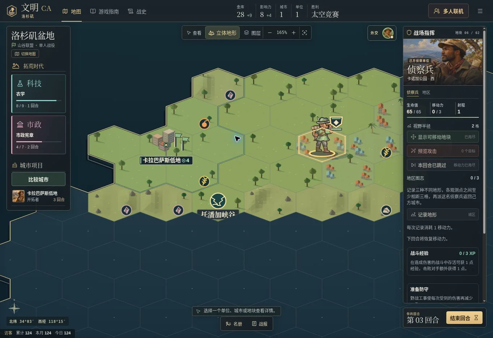

# Civilization CA · 加州战役

一款可供 1–4 人游玩的回合制策略游戏。你带领一名开拓者来到加州，选择在哪里建都，然后一步步探索洛杉矶、旧金山湾或圣迭戈湾。沿海城市能修建港口，把船开进内陆水道；擅长科研的城市可以建造大学，缩短通往下一项科技的时间。

**[开始帕萨迪纳新手教程](https://wanzhengyan.github.io/Civilization-CA/game.html?setup=tutorial)** · [开始单人战役](https://wanzhengyan.github.io/Civilization-CA/game.html?setup=solo) · [创建联机房间](https://wanzhengyan.github.io/Civilization-CA/game.html?setup=host)

[游戏主页](https://wanzhengyan.github.io/Civilization-CA/) · [v7.0.65 更新记录](./CHANGELOG.md) · [English](./README.md)

[地图系列版本记录](./VERSIONS.md)



## 第一局怎么玩

点「新手教程」就会来到洛杉矶地图上的帕萨迪纳。这一局没有其他文明，开拓者可以就地建都。每一步都在真实地图上操作。教程单独存档，下次点同一个入口可以继续，完成教学后也能留在这张地图上玩。

1. **先建都，再决定城市要什么。** 用初始开拓者建都，训练侦察兵探路。城市有 3 名居民时才能训练或购买下一名开拓者。单位出城时会带走 1 名居民，3 人口的城市就回到 2 人口。研究「农学」能增加粮食，研究「工坊工程」能解锁工坊并提高生产力。
2. **看看影响力值不值得花。** 点顶部「影响力」，会看到城市自然扩张的下一格土地，以及还要等多少回合。花 6 点影响力可以立刻取得它，也可以保留余额。之后还能花 6 点向接触过的文明派遣使团，或花 3 点更换已经实施的政策。
3. **用右下角按钮逐项处理待办。** 它会打开待选的科技、市政、城市项目，或定位到可行动的单位。单位可以移动，也可以「跳过本回合」。跳过后仍保留移动力，想改变主意可以手动选回来。处理完待办后，按钮才显示「结束回合」。

想赚金币，可以研究「土地测绘」后建商店。想提高科研，可以沿着这条路线研究「地形测绘」并建学院。每座城市都能各建一所学院，四所大学奇观则全地图各限一座。

下一回合的摘要会列出上回合完成的项目。点地图上的城市名牌可查看粮食、住房、人口和生产进度；点右上角已接触文明的头像可看外交档案。游戏内的「游戏指南」还有资源、单位、建筑和奇观的说明。

## 单人和联机

| 模式 | 可以做什么 |
| --- | --- |
| [单人战役](https://wanzhengyan.github.io/Civilization-CA/game.html?setup=solo) | 选择文明、地图地区、尺寸和 0–3 个电脑对手。零对手练习可以按自己的节奏建设。每种地区与地图尺寸分别存档。 |
| [创建房间](https://wanzhengyan.github.io/Civilization-CA/game.html?setup=host) | 房主可安排 2–4 个真人或电脑席位。想合作，就把朋友和自己分在同一队。队友共享视野和已探索的地图，各自指挥本方单位、城市和金库。 |
| [加入房间](https://wanzhengyan.github.io/Civilization-CA/game.html?setup=join) | 输入房间码，或使用房主分享的邀请链接。玩家可以各自选择英语或简体中文。 |

征服胜利要求控制所有初始首都，或淘汰最后一个敌对队伍。科技胜利要求研究「火箭技术」，然后在一座城市完成「轨道勘测计划」。标准模式允许这两条获胜路线。沿途可以发现自然奇观，也能为 UCLA、斯坦福、加州大学伯克利分校或加州理工选址；四所大学每局各只能建成一次。

## 本地运行

需要 Node.js 22.13 或更新版本。在仓库根目录执行：

```sh
npm run dev
```

打开[本地游戏](http://127.0.0.1:8080/Civilization-CA/)。本地房间数据保存在 `.civitas-local/`。可用第二个浏览器或隐私窗口模拟另一位玩家。运行 `npm test` 检查规则、界面和联机功能，运行 `npm run playtest` 可在三个地区重复试玩 18 局固定开局。

查看[发布流程](./README.md#publish-an-update)、[独立部署联机服务](./README.md#host-your-own-room-service)和[开发测试记录](./DEVELOPMENT.md)。
