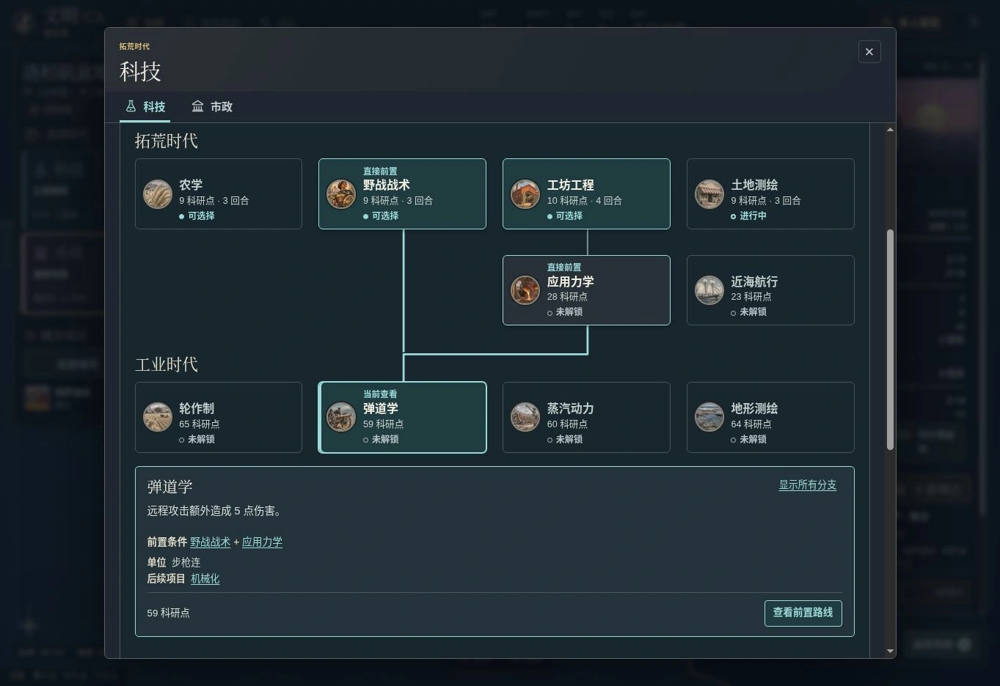
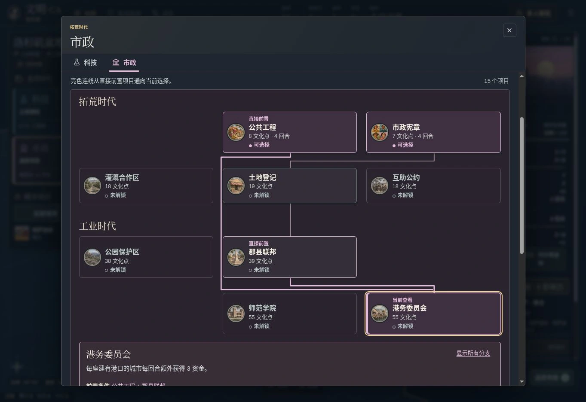
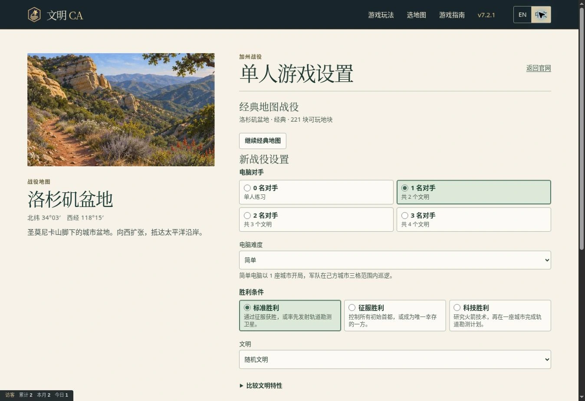

# Civilization CA · 加州战役

一款可供 1–4 人游玩的回合制策略游戏。你带领一名开拓者来到加州，选择在哪里建都，然后一步步探索洛杉矶、旧金山湾或圣迭戈湾。沿海城市能修建港口，把船开进内陆水道；擅长科研的城市可以建造大学，缩短通往下一项科技的时间。

**[开始帕萨迪纳新手教程](https://wanzhengyan.github.io/Civilization-CA/game.html?setup=tutorial)** · [开始单人战役](https://wanzhengyan.github.io/Civilization-CA/game.html?setup=solo) · [创建联机房间](https://wanzhengyan.github.io/Civilization-CA/game.html?setup=host)

[游戏主页](https://wanzhengyan.github.io/Civilization-CA/) · [v7.2.1 更新记录](./CHANGELOG.md) · [English](./README.md)

## 科技树和市政树怎么看

在地图左侧打开「科技」或「市政」，上下滚动查看各个时代。在完整树里点一个项目，亮色连线会标出它的直接前置。在详情中点某个前置项目的名称，还能沿着这条分支往回看。

**怎样研究弹道学？** 「野战战术」和「应用力学」两条线都通向「弹道学」。图中的「野战战术」已经可以研究，「应用力学」则尚未解锁。点「应用力学」就能看到它还需要「工坊工程」。完成两条分支后，就能研究弹道学并解锁步枪连。



**怎样让港口城市多赚金币？** 在市政树里找到「港务委员会」，它需要「公共工程」和「郡县联邦」。点「郡县联邦」可以追溯到「土地登记」。通过港务委员会后，每座有港口的城市都会增加收入。



[观看科技与市政树操作演示（27 秒，MP4）](https://wanzhengyan.github.io/Civilization-CA/film/councils-v721-zh.mp4)

## 第一局怎么玩

点「新手教程」就会来到洛杉矶地图上的帕萨迪纳。这一局没有其他文明，开拓者可以就地建都。每一步都在真实地图上操作。教程单独存档，下次点同一个入口可以继续，完成教学后也能留在这张地图上玩。

1. **先建都，再决定城市要什么。** 用初始开拓者建都，训练侦察兵探路。「城市生产」中的开拓者卡片会显示本城人口。城市有 3 名居民时才能训练或购买下一名开拓者。单位出城时会带走 1 名居民，3 人口的城市就回到 2 人口。研究「农学」能增加粮食，研究「工坊工程」能解锁工坊并提高生产力。
2. **看看影响力值不值得花。** 点顶部「影响力」，会看到城市自然扩张的下一格土地，以及还要等多少回合。花 6 点影响力可以立刻取得它，也可以保留余额。之后还能花 6 点向接触过的文明派遣使团，或花 3 点更换已经实施的政策。
3. **用右下角按钮逐项处理待办。** 它会打开待选的科技、市政、城市项目，或定位到可行动的单位。单位可以移动，也可以「跳过本回合」。跳过后仍保留移动力，想改变主意可以手动选回来。处理完待办后，按钮才显示「结束回合」。

打开左侧生产面板，镜头会移到当前城市，标题显示城名和坐标。学院等建筑可以点选高亮地块。城墙固定建在市中心；研究机械化后，已有城墙的城市可以建造现代城防，每回合一次炮击两格内可见的敌方野战部队。

## 军队与对手

新战役中，每个简单电脑有 1 座城，普通电脑有 3 座城，困难电脑有 5 座城，每座城都是 1 人口。真人玩家仍用开局的开拓者选址建都。

打开金库可以查看总收入、部队维护费和净收入。民兵、野战炮兵和装甲纵队每次收获分别花费 1、4 和 6 金币。训练和升级前均可查看长期费用。国库不足时会记下欠费，可以让部队退役或增加收入。

围城时先扣城市生命，每支驻军受到城市实际损失生命值的 25%，四舍五入。例如将城市从 24 生命打到 1，每支驻军损失 6 点。能占城的地面部队若在反击后存活并夺城，剩余驻军全部被清除。

## 在战役中认识加州

从官网首页的「游戏指南 → 加州地名志」或战役中的「菜单 → 加州地名志」进入。试着用中文或英文搜索奥克兰，比较两次人口普查的结果。打开「实地工具 → 实地路线」，可从堡垒角要塞出发，经过金门大桥，再到奥克兰。探索到对应地区后，可以从地点档案返回地图，也可以在地块面板点「阅读地区档案」查阅来源。

地名志收录 **3 个县、9 座城市，以及 6 处实地考察点或海岸工程**。每项数据都有日期信息、单位和地理范围。战役地块是近似位置，产出和移动力由游戏规则计算。这种在策略地图上查阅公共地理数据的设计，参考了[安德烈·卡帕西的 USACiv](https://karpathy.ai/usaciv/)。[美国人口普查局 QuickFacts](https://www.census.gov/quickfacts/) · [堡垒角要塞档案](https://www.nps.gov/places/fort-point.htm)

| 想做什么 | 从哪里开始 |
| --- | --- |
| 找到已勘探的资源，或决定去哪里建城 | 在「地图探索器」中查看可用地点，再打开「专题地图」检查周边土地和实际用途。 |
| 弄清城市缺粮或生产缓慢的原因 | 从「比较城市」进入「城市档案」，查看未来收成和建设收益。「菜单 → 顾问团」可比较当前可执行的行动。 |
| 给另一座城市送物资 | 打开「物资账簿」，比较已探索的陆路，核对货物与费用，再派出车队。 |
| 给侦察兵安排长期任务 | 选中侦察兵，打开「野外考察」，接受委托、记录观察，再提交报告。 |

## 单人和联机

在首页选好地区后打开设置，地图会保留你选的地区。设置页会显示该地区的风景，并沿用首页的导航和语言切换按钮。你可以在这里选择电脑对手和胜利规则。



| 模式 | 可以做什么 |
| --- | --- |
| [单人战役](https://wanzhengyan.github.io/Civilization-CA/game.html?setup=solo) | 选择文明、地图地区、尺寸和 0–3 个电脑对手。零对手练习可以按自己的节奏建设。每种地区与地图尺寸分别存档。 |
| [创建房间](https://wanzhengyan.github.io/Civilization-CA/game.html?setup=host) | 房主可安排 2–4 个真人或电脑席位。想合作，就把朋友和自己分在同一队。队友共享视野和已探索的地图，各自指挥本方单位、城市和金库。 |
| [加入房间](https://wanzhengyan.github.io/Civilization-CA/game.html?setup=join) | 输入房间码，或使用房主分享的邀请链接。玩家可以各自选择英语或简体中文。 |

征服胜利要求控制所有初始首都，或淘汰最后一个敌对队伍。科技胜利要求研究「火箭技术」，然后在一座城市完成「轨道勘测计划」。标准模式允许这两条获胜路线。沿途可以发现自然奇观，也能为 UCLA、斯坦福、加州大学伯克利分校或加州理工选址；四所大学每局各只能建成一次。

## 本地运行

需要 Node.js 22.13 或更新版本。在仓库根目录执行：

```sh
npm run dev
```

打开[本地游戏](http://127.0.0.1:8080/Civilization-CA/)。本地房间数据保存在 `.civitas-local/`。可用第二个浏览器或隐私窗口模拟另一位玩家。运行 `npm test` 检查规则、界面和联机功能，运行 `npm run playtest` 可在三个地区重复试玩 18 局固定开局。

查看[发布流程](./README.md#publish-an-update)、[独立部署联机服务](./README.md#host-your-own-room-service)、[开发测试记录](./DEVELOPMENT.md)与[100 个可玩版本的逐版改动](./VERSIONS.md)。
